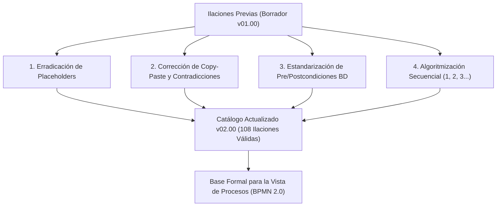
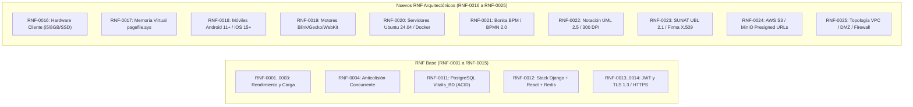

# Guía Técnica de Defensa: Refinamiento Integral de Ilaciones (ILA) y Requerimientos No Funcionales (RNF)

**Proyecto:** NexoVitalis360 &bull; Plataforma Hospitalaria Especializada en Neuropediatría  
**Equipo:** RuwayLabs Perú (Grupo RUWAY) &bull; Universidad Nacional de San Agustín (UNSA)  
**Asignatura:** Diseño y Arquitectura de Software &bull; **Docente:** M.Sc. Percy Oscar Huertas Niquén  
**Documentos de Origen:** [Artefacto_Ilación_v02.00.docx](file:///C:/Users/marco/Desktop/TEO-DAS/Diseño%20y%20Arquitectura%20de%20Software%20-%20RuwayLabs/Catálogo%20actualizado/Artefacto_Ilación_v02.00.docx) y [Requerimientos_No_Funcionales_v2.00.docx](file:///C:/Users/marco/Desktop/TEO-DAS/Diseño%20y%20Arquitectura%20de%20Software%20-%20RuwayLabs/Catálogo%20actualizado/Requerimientos_No_Funcionales_v2.00.docx)

---

## 1. El Fundamento Doctrinal del Catálogo de Requisitos

> [!IMPORTANT]
> **La Doctrina del Docente (M.Sc. Percy Oscar Huertas Niquén):**  
> *"El catálogo de requisitos es un elemento, un documento dinámico que se va actualizando hasta el final. Porque hay cosas que no aparecen al comienzo y uno no tiene la visión de colocarlas. Fíjense: tiene que ser una herramienta de doble sentido. Todo lo que está en la arquitectura tiene que aparecer en los requisitos no funcionales, y lo que está en la funcionalidad tiene que nacer de la educción y la ilación. Si en una casa de desarrollo les piden hacer la arquitectura, ¿qué preguntan primero? El catálogo. Si no, ¿sobre qué requisitos hago las cosas?"*

Bajo esta estricta directriz, el equipo RuwayLabs no concibe la arquitectura como un ejercicio de dibujo abstracto o desconectado, sino como una **proyección exacta, biunívoca y verificable** del Catálogo de Requisitos actualizado. 

A continuación se detalla exhaustivamente qué se arregló, por qué se corrigió y cómo se sincronizó tanto en las **Ilaciones** como en los **Requerimientos No Funcionales**.

---

## 2. ¿Qué se arregló en las Ilaciones (`ILA-0001` a `ILA-0113`)?

En versiones preliminares, el artefacto de ilaciones presentaba inconsistencias heredadas de la etapa de requerimientos que impedían su uso directo como modelo de procesos de arquitectura. Se aplicaron cuatro grandes transformaciones estructurales:

### A. Erradicación Total de Placeholders y Metadatos Incompletos
* **Problema anterior:** Existían casillas con textos genéricos como `ESP-DDDD`, `ILA-DDDD`, `GUI-PENDIENTE`, `Ninguno` o `Pendiente de asignación`.
* **Solución aplicada:** Se auditaron y completaron las **108 ilaciones activas** (derivadas de las 27 educciones operativas: 4 ilaciones CRUD por educción: Crear, Consultar, Modificar, Eliminar/Inactivar).
* **Trazabilidad 100% cerrada:** Cada ilación cuenta ahora con:
  1. Su código formal correlativo (`ILA-XXXX`).
  2. Su educción padre vinculada (`EDU-XXXX`).
  3. Su interfaz gráfica oficial (`GUI-XXXX`) y modal flotante (`MDL-XXXX`).
  4. Los controles de interfaz accionables con nomenclatura nemónica (`BTN_XXXX`, `SEL_XXXX`, `FLD_XXXX`, `TBL_XXXX`).
  5. Las tablas de base de datos exactas de la instancia `Vitalis_BD` (`TB_*`).
  6. Los actores responsables (`ACT-0001: Especialista`, `ACT-0002: Recepcionista`, `ACT-0003: Apoderado/Paciente`).
  7. Los requerimientos no funcionales (`RNF-XXXX`) que condicionan su ejecución.

---

### B. Corrección de Errores Críticos de Copy-Paste y Lógica de Negocio

Se identificaron y reescribieron por completo aquellas ilaciones que arrastraban textos copiados de otros módulos o lógicas contradictorias:

| Ilación | Defecto Detectado en Versión Anterior | Corrección y Refinamiento Técnico Aplicado |
| :---: | :--- | :--- |
| **`ILA-0005`** | Referenciaba modales de pacientes en lugar de la auditoría de citas. | Se reescribió para gestionar exclusivamente la auditoría transaccional de estados en `TB_HISTORIAL_CITAS` y `MDL-HIST-03`. |
| **`ILA-0017`** *(Cita Médica)* | Procedimiento ambiguo sin validaciones previas de seguridad médica ni financiera. | **Se transformó en el proceso transaccional pivote:** Validación previa de consentimiento bioético (`TB_CONSENTIMIENTOS`), pre-triaje (`TB_PRETRIAJE_CLINICO`), saldo de paquete (`TB_PAQUETES_SESIONES`) y **bloqueo pesimista anticolisión** en `TB_HORARIOS`. |
| **`ILA-0019`** *(Teleconsulta)* | No especificaba la generación técnica de la videollamada. | Incorporación de aprovisionamiento de sala virtual Google Meet vía API OAuth2, guardando enlace y PIN en `TB_ENLACES_VIDEOCONFERENCIA`. |
| **`ILA-0021` / `ILA-0022`** | Datos de contacto mezclados entre el niño y el apoderado. | Separación estricta del menor (paciente neurológico sin capacidad jurídica) del apoderado/tutor legal en `TB_APODERADOS` con patria potestad. |
| **`ILA-0029` a `ILA-0032`** | Permitía cancelaciones inmediatas sin regla de negocio. | Se incorporó la **regla de anticipación mínima de 24 horas** ($T \ge 24\text{h}$) para reprogramación y liberación de franja en `TB_REPROGRAMACIONES`. |
| **`ILA-0054`** | Notas de evolución sin firmas ni cierre de historia. | Obligatoriedad de firma digital médica y transición de la historia clínica a estado inmutable `CERRADA`. |
| **`ILA-0062`** *(Pre-Triaje)* | No evaluaba la urgencia médica del infante. | **Algoritmo de alerta clínica:** Evaluación automática de signos vitales (presión arterial, SpO2 $< 92\%$, FC anormal); si detecta riesgo vital, conmuta atómicamente el flag booleano `alerta_roja = true` en `TB_PRETRIAJE_CLINICO` y dispara WebSockets hacia urgencias. |
| **`ILA-0065`** | Consentimiento informado sin trazabilidad legal. | Registro probatorio con timestamp, IP, DNI del apoderado y hash SHA-256 del acta firmada en `TB_CONSENTIMIENTOS`. |
| **`ILA-0094` a `ILA-0097`** | Liquidación médica sin retenciones ni cálculo de sesiones. | Algoritmo contable sobre `TB_LIQUIDACIONES`: cruce de citas atendidas en el periodo, deducción de comisiones del centro y retención de cuarta categoría. |
| **`ILA-0106` a `ILA-0109`** *(Facturación)* | Comprobantes genéricos sin validez fiscal peruana. | Generación de XML bajo estándar **SUNAT UBL 2.1**, bifurcación entre Boleta (DNI) y Factura (RUC/Razón Social), firma digital X.509 y obtención de CDR en `TB_COMPROBANTES`. |

---

### C. Estandarización Metodológica de Precondiciones y Postcondiciones

El docente exigió una regla formal de operación sobre la persistencia relacional que no se cumplía uniformemente. Se normalizó la totalidad de las 108 ilaciones bajo este estándar:

1. **Precondición Estándar:**
   > *"La Base de Datos relacional Vitalis_BD se encuentra activa y con las tablas TB_[NOMBRE_TABLA] disponibles y abiertas para lectura/escritura."*
2. **Postcondición Estándar:**
   > *"La tabla TB_[NOMBRE_TABLA] se cierra atómicamente tras consolidar la transacción, **dejando la Base de Datos (Vitalis_BD) abierta para más consultas**."*

Esta estandarización refleja que la conexión con el motor relacional (PostgreSQL) se mantiene abierta mediante un pool de conexiones (`PgBouncer`), cerrando únicamente los cursores o transacciones individuales de cada tabla.

---

### D. Algoritmización Secuencial (1, 2, 3...) y Saltos Lógicos Condicionales

* **La directriz del docente:** *"Las ilaciones tienen unos numeritos que van en orden: 1, 2, 3... y se van saltando dependiendo de la lógica. Esos son procesos."*
* **Lo que se arregló:** Se reestructuró la sección de procedimientos de cada ilación eliminando descripciones narrativas planas y transformándolas en **algoritmos secuenciales numerados** con saltos condicionales explícitos:
  - *Sintaxis incorporada:* `"Si [condición de fallo o regla de negocio], el sistema muestra [mensaje] y salta al paso Y; en caso contrario, continúa en el paso X."*
  - *Manejo de excepciones:* Cada proceso detalla qué ocurre si el actor presiona `CANCELAR`, si hay conflicto de concurrencia o si falla una validación externa, definiendo los puntos exactos de bifurcación o retorno.

---

## 3. ¿Qué se arregló y agregó en los Requerimientos No Funcionales (`RNF`)?

El Catálogo de Requisitos original culminaba en `RNF-0010` o tenía duplicados, careciendo de especificaciones sobre el hardware de los clientes, la memoria virtual, los sistemas operativos, los motores de navegación y la infraestructura de servidores.

Se depuraron los existentes y se incorporaron **10 nuevos RNF formales**, alcanzando un total de **25 requerimientos no funcionales (RNF-0001 a RNF-0025)** rigurosamente clasificados bajo la norma **ISO/IEC 25010**:

### Detalle de los 10 Nuevos RNF que Sustentan la Arquitectura

1. **`RNF-0016: Hardware y Sistema Operativo de Estaciones de Trabajo del Cliente`**
   - *¿Por qué se agregó?:* La cátedra exigió documentar con qué equipos cuenta el cliente.
   - *Especificación:* PC Recepción y Laptop Consulta con arquitectura x86_64, procesador Intel Core i5 (10ma Gen+, 4 cores/8 threads a 2.5 GHz+) o AMD Ryzen 5, 8 GB/16 GB RAM DDR4, SSD NVMe 256 GB, monitor Full HD (1920x1080), webcam 1080p, Windows 11/10 Pro de 64 bits.

2. **`RNF-0017: Gestión de Memoria Virtual del SO y Paginación en Clientes`**
   - *¿Por qué se agregó?:* Para resolver la interrogante técnica del profesor: *"¿Cómo ataca el sistema operativo a la memoria y evita que se cuelgue el navegador?"*.
   - *Especificación:* Archivo de paginación `pagefile.sys` configurado en SSD entre 1.5x y 2.0x la RAM física (12 GB a 16 GB reservada). En la aplicación React 18, contención del heap de JavaScript (V8) a un máximo de **350 MB por pestaña** mediante `React.lazy`, code splitting y virtualización de tablas.

3. **`RNF-0018: Compatibilidad con Dispositivos Móviles Multi-Fabricante`**
   - *¿Por qué se agregó?:* Para sustentar los nodos de Smartphone (apoderados) y Tablet (terapias a domicilio).
   - *Especificación:* Android 11.0+ (ARM64, 4 GB RAM, soporte de capas Samsung One UI, Xiaomi HyperOS) e iOS 15.0+ (iPhone/iPad). Persistencia en `SessionStorage` ante caídas de red celular 4G/5G.

4. **`RNF-0019: Motores de Navegadores Web e Interacción con el Sistema Operativo`**
   - *¿Por qué se agregó?:* Estandarización de llamadas del navegador al SO (hilos, sockets TLS, WebRTC).
   - *Especificación:* Compatibilidad certificada en Blink/V8 (Chrome, Edge v120+), Gecko (Firefox v120+) y WebKit (Safari v16+), empleando APIs W3C puras sin extensiones propietarias.

5. **`RNF-0020: Hardware y Sistema Operativo de Servidores de Producción`**
   - *¿Por qué se agregó?:* Para justificar las capacidades del nodo servidor en la Vista Física.
   - *Especificación:* Ubuntu Server 24.04 LTS (Kernel 6.8), Docker Engine 26.x, servidor de apps con 4 vCPUs, 16 GB RAM ECC, 8 GB Swap, SSD RAID-1; servidor de base de datos dedicado con 4 vCPUs, 16 GB RAM ECC y SSD NVMe de 3,000 IOPS con archivado continuo WAL (RPO $\le 15$ min, RTO $\le 30$ min).

6. **`RNF-0021: Herramienta Oficial de Modelado de Procesos (Bonita BPM / BPMN 2.0)`**
   - *¿Por qué se agregó?:* Regla estricta del audio: *"Si van a trabajar con Bonita, ¿dónde tiene que aparecer el nombre de la herramienta? En los Requisitos No Funcionales"*.
   - *Especificación:* Bonita Studio Community Edition v2024.1 bajo notación OMG BPMN 2.0 con 4 carriles de responsabilidad (Actor, SPA, API Django, Vitalis_BD).

7. **`RNF-0022: Herramientas de Modelado Arquitectónico (UML 2.5)`**
   - *¿Por qué se agregó?:* Trazabilidad metodológica de las herramientas empleadas para generar las vistas.
   - *Especificación:* Estándar OMG UML 2.5 e ISO/IEC/IEEE 42010 mediante scripts reproducibles de Python 3.12 (matplotlib a 300 DPI) y modelos vectoriales HTML5 interactivos.

8. **`RNF-0023: Interoperabilidad con Facturación Electrónica SUNAT (UBL 2.1)`**
   - *¿Por qué se agregó?:* Respaldo no funcional para el módulo de facturación (EDU-0037 / ILA-0106).
   - *Especificación:* Despacho de XML UBL 2.1 firmado con certificado X.509 hacia API REST PSE/OSE en menos de 3.0 segundos con Constancia de Recepción (CDR).

9. **`RNF-0024: Almacenamiento Seguro de Objetos para Documentos Clínicos y Vouchers`**
   - *¿Por qué se agregó?:* Prohibición de guardar archivos médicos en el disco local del servidor web.
   - *Especificación:* Bucket compatible con AWS S3 / MinIO vía HTTPS puerto 443/9000, validación de MIME-type (PDF, JPG, PNG $\le 15$ MB) y URLs prefirmadas temporales con expiración de 300 segundos.

10. **`RNF-0025: Topología de Red, Segmentación VPC y Firewall Perimetral`**
    - *¿Por qué se agregó?:* Especificación de los puertos y subredes dibujados en la Vista Física.
    - *Especificación:* Red Privada Virtual (VPC) con Subred Pública DMZ (Nginx puerto 443 HTTPS/WSS, Rate Limiting 100 req/min) y Subred Privada Aislada (Django puerto 8000, Redis puerto 6379 y PostgreSQL puerto 5432 sin acceso directo desde Internet).

---

## 4. Matriz Comparativa: Antes vs. Después del Refinamiento

| Dimensión de Calidad | Estado Anterior (Borrador Hito 1) | Estado Refinado Actual (Hito 2 Definitivo) |
| :--- | :--- | :--- |
| **Completitud de Ilaciones** | Textos genéricos (`ESP-DDDD`, `ILA-DDDD`, `Ninguno`). | **108 ilaciones 100% completas** con IDs, controles, modales y tablas. |
| **Secuencia de Procedimientos** | Párrafos narrativos continuos sin bifurcaciones. | **Pasos numerados 1, 2, 3... con saltos condicionales** algorítmicos. |
| **Persistencia en BD** | Menciones ambiguas o faltantes de tablas. | **Pre/Postcondición formal obligatoria:** cierre de `TB_*` y `Vitalis_BD` abierta. |
| **Alcance de los RNF** | 10 a 15 requisitos genéricos sin hardware ni software. | **25 RNF rigurosos** cubriendo cliente, servidor, memoria virtual, SO y herramientas. |
| **Trazabilidad Instrumental** | Bonita BPM y UML ausentes en el catálogo. | **Registrados formalmente en RNF-0021 y RNF-0022**. |
| **Correspondencia con Vistas** | Desfase entre diagramas y catálogo. | **Correspondencia biunívoca 100%:** Todo lo dibujado está en el catálogo. |

---

## 5. Guion Rápido para Defender este Refinamiento ante el Docente

Cuando el docente pregunte: **"¿Por qué modificaron el catálogo de requisitos si ya lo habían entregado en el curso anterior?"**, la respuesta técnica y contundente es:

1. *"Ingeniero, seguimos rigurosamente su directriz pedagógica: **el catálogo de requisitos es un documento dinámico que evoluciona junto con la arquitectura**."*
2. *"Al diseñar la **Vista Física**, descubrimos que faltaba la especificación técnica de las máquinas del cliente (Intel i5, RAM, SSD), cómo el Sistema Operativo gestiona la memoria virtual (`pagefile.sys`), los servidores de producción (Ubuntu 24.04, Docker) y los protocolos seguros (TLS 1.3, WSS, puertos 443, 5432, 6379). Siguiendo su indicación de **doble sentido**, fuimos al catálogo e incorporamos los requerimientos **RNF-0016 al RNF-0025**."*
3. *"Asimismo, registramos en **RNF-0021** la herramienta **Bonita BPM** que utilizamos para modelar la **Vista de Procesos**."*
4. *"Finalmente, en las **Ilaciones**, transformamos las descripciones narrativas en **procesos algorítmicos numerados (1, 2, 3...) con saltos condicionales y pre/postcondiciones exactas de base de datos** (`TB_*`), logrando que cada diagrama de procesos BPMN sea un reflejo matemático directo de la ilación correspondiente."*
