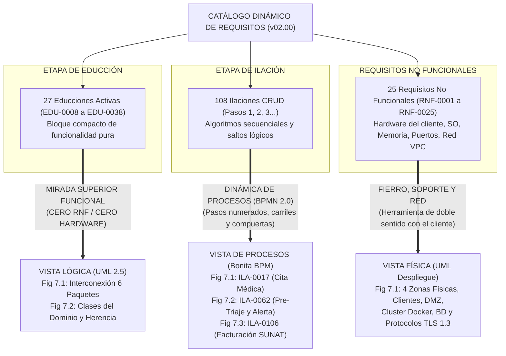
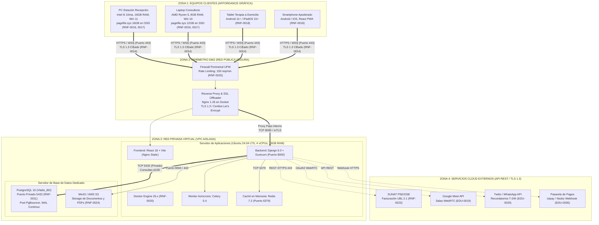

# Guía Maestra de Vistas Arquitectónicas (Hito 2): Vista Lógica, Procesos y Física

**Proyecto:** NexoVitalis360 &bull; Sistema Hospitalario Integral en Neuropediatría  
**Equipo:** RuwayLabs Perú (Grupo RUWAY) &bull; Universidad Nacional de San Agustín (UNSA)  
**Asignatura:** Diseño y Arquitectura de Software &bull; **Docente:** M.Sc. Percy Oscar Huertas Niquén  
**Documentos Oficiales Generados:**
- [Vista Lógica v01.00.docx](file:///C:/Users/marco/Desktop/TEO-DAS/Diseño%20y%20Arquitectura%20de%20Software%20-%20RuwayLabs/Hito%202/02_Artefactos_Arquitectura/03_Vista_Logica/Vista%20Lógica%20v01.00.docx)
- [Vista de Procesos v01.00.docx](file:///C:/Users/marco/Desktop/TEO-DAS/Diseño%20y%20Arquitectura%20de%20Software%20-%20RuwayLabs/Hito%202/02_Artefactos_Arquitectura/04_Vista_Procesos/Vista%20de%20Procesos%20v01.00.docx)
- [Vista Física v01.00.docx](file:///C:/Users/marco/Desktop/TEO-DAS/Diseño%20y%20Arquitectura%20de%20Software%20-%20RuwayLabs/Hito%202/02_Artefactos_Arquitectura/05_Vista_Fisica/Vista%20Física%20v01.00.docx)

---

## 1. La Doctrina de Cátedra: Origen y Separación de Incumbencias

El diseño de la arquitectura de software en NexoVitalis360 responde a la doctrina metodológica impartida por el docente, la cual establece con rigurosidad de dónde nace cada una de las tres vistas y qué está estrictamente permitido y prohibido en cada una:

---

## 2. Vista Lógica: La Mirada Superior sobre la Educción

### A. ¿De dónde sale la Vista Lógica?
> [!IMPORTANT]
> **Definición de Cátedra:**  
> *"La Vista Lógica va a contener una mirada de todo el sistema que se va a construir desde el ángulo de vista de sus aspectos de funcionalidad. ¿Dónde están los aspectos de funcionalidad en el catálogo? **En la educción**. Miro la educción porque es un bloque más compacto que la ilación y veo cómo se conectan los módulos. ¿Tiene algo que ver con los requisitos no funcionales? **No tiene nada que ver. Por lo tanto, en esta vista lógica no tiene que aparecer nada con respecto a los requisitos no funcionales. Solamente la funcionalidad del sistema.**"*

La Vista Lógica se desprende directamente de las **27 educciones activas** (`EDU-0008` a `EDU-0038`) del Catálogo de Requisitos. Modela las responsabilidades del sistema como componentes desacoplados de alto nivel sin contaminar el diseño con decisiones de infraestructura física (ni servidores, ni sistemas operativos, ni marcas comerciales).

---

### B. Análisis de los Diagramas de Vista Lógica

#### 1. Figura 7.1 / 3.1: Interconexión Modular de las 27 Educciones en 6 Paquetes Modulares
* **Archivo Interactivo:** [`Figura_3_1_Vista_Logica_Educciones_v01.00.html`](file:///C:/Users/marco/Desktop/TEO-DAS/DAS-GITHUB/05_DIAGRAMAS_Y_RECURSOS_EDITABLES/03_Vista_Logica/Figura_3_1_Vista_Logica_Educciones_v01.00.html)
* **Render Gráfico Hi-DPI:** [`07_vista_logica_educciones.png`](file:///C:/Users/marco/Desktop/TEO-DAS/scratch_img/07_vista_logica_educciones.png) (3663 × 2241 px)
* **¿Qué contiene?:**
  Organiza el 100% de las educciones en 6 paquetes funcionales estructurados bajo el estereotipo `«subsystem»`:
  1. `PKG-01: Filiación y Pre-Triaje Clínico` (EDU-0014, EDU-0021, EDU-0022, EDU-0023, EDU-0035).
  2. `PKG-02: Citas y Agendas Médicas (Núcleo Central)` (EDU-0008, EDU-0012, EDU-0013, EDU-0016, EDU-0017, EDU-0018).
  3. `PKG-03: Historia Clínica y Terapias` (EDU-0010, EDU-0015, EDU-0020, EDU-0025, EDU-0026, EDU-0027, EDU-0034).
  4. `PKG-04: Teleconsulta Multimodal y Encuestas` (EDU-0019, EDU-0036).
  5. `PKG-05: Pagos, Facturación y Caja` (EDU-0024, EDU-0028, EDU-0029, EDU-0037).
  6. `PKG-06: Permisos, Auditoría y Reportes BI` (EDU-0009, EDU-0011, EDU-0038).
* **Conexiones:** Relaciones formales de dependencia `«use»` e `«import»` que demuestran que el subsistema de Citas (PKG-02) es el pivote transaccional hacia la historia clínica (PKG-03) y facturación (PKG-05).
* **Cumplimiento de Regla de Cátedra:** **CERO RNF**. No hay bases de datos, no hay Docker, no hay Ubuntu, no hay puertos TCP. Es lógica y modularidad pura.

---

#### 2. Figura 7.2: Diagrama de Bloques Funcionales Nivel 1 (Cuerpo Principal - Sección 7.3)
* **Archivo Interactivo:** [`fig7_3_bloques_funcionales_nivel1.html`](file:///C:/Users/marco/Desktop/TEO-DAS/DAS-GITHUB/05_DIAGRAMAS_Y_RECURSOS_EDITABLES/VISOR_HTML_ARQUITECTURA_v01.00/fig7_3_bloques_funcionales_nivel1.html) / [`Figura_3_3_Vista_Logica_Bloques_Funcionales_v01.00.html`](file:///C:/Users/marco/Desktop/TEO-DAS/DAS-GITHUB/05_DIAGRAMAS_Y_RECURSOS_EDITABLES/03_Vista_Logica/Figura_3_3_Vista_Logica_Bloques_Funcionales_v01.00.html)
* **Render Gráfico Hi-DPI:** [`Figura_3_3_Vista_Logica_Bloques_Funcionales_v01.00.png`](file:///C:/Users/marco/Desktop/TEO-DAS/DAS-GITHUB/05_DIAGRAMAS_Y_RECURSOS_EDITABLES/03_Vista_Logica/Figura_3_3_Vista_Logica_Bloques_Funcionales_v01.00.png)
* **¿Qué contiene?:**
  Conforme al feedback docente (M.Sc. Percy Oscar Huertas Niquén), este diagrama representa formalmente la descomposición funcional del sistema en 11 bloques modulares (**B1** a **B11**), su frontera del sistema y el catálogo exhaustivo de los **28 flujos correlativos** (**F1** a **F28**) que cubren el 100% de las 28 educciones en el cuerpo principal de la Vista Lógica.

---

### C. Anexo 1: Diagrama de Clases UML 2.5 y Modelo de Dominio Clínico (Sección 11 - Bajo Nivel)
* **Archivo Interactivo:** [`Anexo_1_Vista_Logica_Clases_UML.html`](file:///C:/Users/marco/Desktop/TEO-DAS/DAS-GITHUB/05_DIAGRAMAS_Y_RECURSOS_EDITABLES/09_Anexos/Anexo_1_Vista_Logica_Clases_UML.html) / [`fig3_2_vista_logica_clases_uml.html`](file:///C:/Users/marco/Desktop/TEO-DAS/DAS-GITHUB/05_DIAGRAMAS_Y_RECURSOS_EDITABLES/VISOR_HTML_ARQUITECTURA_v01.00/fig3_2_vista_logica_clases_uml.html)
* **Render Gráfico Hi-DPI:** [`08_vista_logica_clases_uml.png`](file:///C:/Users/marco/Desktop/TEO-DAS/scratch_img/08_vista_logica_clases_uml.png) (3569 × 2358 px)
* **¿Por qué se ubica como Anexo?:**
  Siguiendo las indicaciones del docente, el diagrama de clases UML 2.5 describe la estructura interna de bajo nivel (atributos, operaciones CRUD, visibilidad pública/privada y mapeo relacional a tablas `TB_*`). Por ello, se traslada formalmente a la sección de **Anexos** (Anexo 1 del documento y sección dedicada en el Visor HTML), preservando su valor de diseño detallado sin sobrecargar el cuerpo principal de la Vista Lógica.
* **¿Qué contiene?:**
* **Archivo Interactivo:** [`Figura_3_2_Vista_Logica_Clases_UML_v01.00.html`](file:///C:/Users/marco/Desktop/TEO-DAS/DAS-GITHUB/05_DIAGRAMAS_Y_RECURSOS_EDITABLES/03_Vista_Logica/Figura_3_2_Vista_Logica_Clases_UML_v01.00.html)
* **Render Gráfico Hi-DPI:** [`08_vista_logica_clases_uml.png`](file:///C:/Users/marco/Desktop/TEO-DAS/scratch_img/08_vista_logica_clases_uml.png) (3569 × 2358 px)
* **¿Qué contiene?:**
  1. **Árbol Ortogonal Canónico de Herencia (Generalización):**
     - Superclase abstracta: `Persona` (atributos encapsulados: `id_persona`, `dni_documento`, `nombres`, `apellidos`, `fecha_nacimiento`).
     - Subclases que heredan mediante un bus horizontal unificado ($y=305$) y vástago vertical con triángulo blanco cerrado (`──▷`):
       - `Paciente` (añade `tipo_sangre`, `alergias_cronicas`, consentimiento bioético).
       - `Apoderado` (añade `vinculo_parentesco`, patria potestad del menor).
       - `Especialista` (añade `nro_colegiatura_cmp`, `nro_rne_subespecialidad`).
  2. **Composiciones Fuertes (`◆` Rombo Negro Sólido):**
     - Relaciones existenciales estrictas con destrucción en cascada:
       - `Paciente` $\blacklozenge$--- (1) `HistoriaClinica` (la historia clínica no existe sin el paciente).
       - `HistoriaClinica` $\blacklozenge$--- (0..*) `EvolucionSesion` y `RecetaMedica`.
       - `EvolucionSesion` $\blacklozenge$--- (1..*) `DiagnosticoCIE10` (codificación internacional neuropediátrica).
       - `CitaMedica` $\blacklozenge$--- (0..1) `PreTriajeClinico`.
       - `ComprobantePago` $\blacklozenge$--- (1..*) `PagoVoucher`.
  3. **Agregaciones Débiles (`◇` Rombo Blanco con Borde Negro):**
     - Relaciones todo-parte con ciclo de vida independiente:
       - `Especialista` $\lozenge$--- (1..*) `HorarioDisponibilidad`.
       - `CitaMedica` $\lozenge$--- (0..1) `TeleconsultaSession` (la sesión WebRTC existe temporalmente durante la teleconsulta).
  4. **Multiplicidades y Roles:** Cardinalidades exactas (`1`, `1..*`, `0..1`, `0..*`) y rol `tutela` entre apoderado y paciente menor.
  5. **Mapeo Relacional Físico:** Cada entidad referencia su tabla de almacenamiento en `Vitalis_BD` (`TB_PACIENTE`, `TB_CITA_MEDICA`, etc.).
  6. **Leyenda Formal UML:** Ubicada en el cuadrante superior izquierdo con el significado de cada conector.

---

## 3. Vista de Procesos: La Dinámica Algorítmica de las Ilaciones

### A. ¿De dónde sale la Vista de Procesos?
> [!IMPORTANT]
> **Definición de Cátedra:**  
> *"¿Dónde están los procesos dentro del catálogo de requisitos? **En la ilación**. Las ilaciones en la parte de la descripción tienen unos numeritos que van en orden: 1, 2, 3... y se van saltando dependiendo de la lógica. Esos son procesos. La vista de procesos es simplemente un diagrama de procesos o diagrama de flujo sobre los elementos de la ilación. Si alguna de las ilaciones causa desconocimiento o complejidad, para esa ilación se hace la vista de procesos. **Escojan 3 ilaciones críticas y represéntenlas.** Si dicen que van a trabajar con Bonita, **el nombre de la herramienta tiene que aparecer en los Requisitos No Funcionales**."*

La Vista de Procesos surge de la formalización algorítmica de las ilaciones. Mientras que la Vista Lógica modela la estructura estática (*qué clases existen*), la Vista de Procesos modela la dinámica temporal y transaccional (*cómo se orquestan las llamadas, decisiones, bloqueos pesimistas y persistencias a lo largo del tiempo*).

---

### B. Análisis de los 3 Procesos BPMN 2.0 Seleccionados

Siguiendo la exigencia del docente, se seleccionaron **3 ilaciones críticas** de alta complejidad transaccional, modeladas en **Bonita BPM 2024.1 / BPMN 2.0** (respaldado en `RNF-0021`):

#### 1. Proceso 01: Ilación ILA-0017 — Crear Registro de Cita Médica (EDU-0012)
* **Archivo Interactivo:** [`Figura_4_1_Vista_Procesos_ILA0017_v01.00.html`](file:///C:/Users/marco/Desktop/TEO-DAS/DAS-GITHUB/05_DIAGRAMAS_Y_RECURSOS_EDITABLES/04_Vista_Procesos/Figura_4_1_Vista_Procesos_ILA0017_v01.00.html)
* **Render Gráfico Hi-DPI:** [`09_vista_procesos_ila0017.png`](file:///C:/Users/marco/Desktop/TEO-DAS/scratch_img/09_vista_procesos_ila0017.png) (2840 × 1714 px)
* **Estructura:** 4 Carriles de responsabilidad (*Swimlanes*):
  - *Carril 1:* Paciente / Apoderado (Actor).
  - *Carril 2:* Recepción / Asistente (Actor).
  - *Carril 3:* Backend Django REST Framework (Sistema).
  - *Carril 4:* Pasarela de Pagos / Google Meet / Vitalis_BD (Integraciones).
* **Puntos Críticos de Decisión:**
  - **Paso 4 (Compuerta XOR 1):** Valida paquete con sesiones activas, consentimiento firmado y pre-triaje. Si no cumple $\rightarrow$ Salta al Paso 11 (Bloqueo clínico/financiero y fin anormal).
  - **Paso 7 (Bloqueo Pesimista):** Adquiere bloqueo pesimista en `TB_HORARIOS` con `SELECT FOR UPDATE` para evitar colisiones de reserva concurrentes (respaldo de `RNF-0004`).
  - **Paso 8 (Compuerta XOR 2):** Si el usuario presiona Cancelar $\rightarrow$ Libera franja y salta al Paso 11.
  - **Paso 9 (Compuerta XOR 3):** Detección de colisión concurrente: si la franja fue tomada por otro usuario en el mismo milisegundo $\rightarrow$ Retorna al Paso 6 (recargar horarios libres).

---

#### 2. Proceso 02: Ilación ILA-0062 — Pre-Triaje Clínico y Alerta Roja (EDU-0023)
* **Archivo Interactivo:** [`Figura_4_2_Vista_Procesos_ILA0062_v01.00.html`](file:///C:/Users/marco/Desktop/TEO-DAS/DAS-GITHUB/05_DIAGRAMAS_Y_RECURSOS_EDITABLES/04_Vista_Procesos/Figura_4_2_Vista_Procesos_ILA0062_v01.00.html)
* **Render Gráfico Hi-DPI:** [`10_vista_procesos_ila0062.png`](file:///C:/Users/marco/Desktop/TEO-DAS/scratch_img/10_vista_procesos_ila0062.png) (3046 × 1686 px)
* **Estructura:** 4 Carriles (Apoderado/Paciente, Enfermería/Triaje, Motor Clínico Django, Vitalis_BD).
* **Puntos Críticos de Decisión:**
  - **Paso 6 (Compuerta XOR 1):** Cancelación voluntaria del formulario $\rightarrow$ Salta al Paso 10 sin persistir.
  - **Paso 7 (Compuerta XOR 2):** Validación de completitud de signos vitales (presión arterial sistólica/diastólica, saturación SpO2, FC). Si faltan valores $\rightarrow$ Retorna al Paso 4.
  - **Paso 8 (Compuerta XOR 3 - Regla de Severidad Clínica):**
    - Si SpO2 $< 92\%$ o taquicardia severa $\rightarrow$ Conmuta `alerta_roja = true`, inserta en `TB_PRETRIAJE_CLINICO` y emite evento WebSocket inmediato a la guardia médica de urgencias.
    - Si los parámetros son normales $\rightarrow$ Conmuta `alerta_roja = false` y habilita el agendamiento estándar.

---

#### 3. Proceso 03: Ilación ILA-0106 — Facturación Electrónica SUNAT (EDU-0037)
* **Archivo Interactivo:** [`Figura_4_3_Vista_Procesos_ILA0106_v01.00.html`](file:///C:/Users/marco/Desktop/TEO-DAS/DAS-GITHUB/05_DIAGRAMAS_Y_RECURSOS_EDITABLES/04_Vista_Procesos/Figura_4_3_Vista_Procesos_ILA0106_v01.00.html)
* **Render Gráfico Hi-DPI:** [`11_vista_procesos_ila0106.png`](file:///C:/Users/marco/Desktop/TEO-DAS/scratch_img/11_vista_procesos_ila0106.png) (3046 × 1677 px)
* **Estructura:** 4 Carriles (Caja/Admisión, Facturación Django, Servidor PSE/OSE, API SUNAT).
* **Puntos Críticos de Decisión:**
  - **Paso 4 (Compuerta de Bifurcación Tributaria):**
    - Si el comprobante es **Boleta** $\rightarrow$ Paso 5: Valida DNI del titular (8 dígitos).
    - Si el comprobante es **Factura** $\rightarrow$ Paso 6: Valida RUC (11 dígitos con dígito verificador) y consulta Razón Social/Estado Habido.
  - **Paso 10 (Firma y Despacho SUNAT):** Construcción del documento XML bajo estándar **UBL 2.1**, firmado con certificado digital X.509 y envío asíncrono sobre HTTPS/TLS 1.3 al PSE/OSE (respaldo de `RNF-0023`).
  - **Paso 11:** Obtención de la Constancia de Recepción (CDR), almacenamiento en `TB_COMPROBANTES` y generación del PDF con código QR y Hash CPE.

---

## 4. Vista Física: El Fierro, el Soporte y el Despliegue de Red

### A. ¿De dónde sale la Vista Física?
> [!IMPORTANT]
> **Definición de Cátedra:**  
> *"La vista física contiene dos aspectos importantes: **el software y el hardware**. Tienen que hacer un diagrama en el cual se note cómo usted va a utilizar el software y el hardware dentro de la construcción del sistema. ¿Dónde está eso? **En los requisitos no funcionales**. Si el requisito no funcional no contiene nada del hardware o del software, van a tener que introducir los elementos que van a definir dentro de la arquitectura hacia el catálogo de requisitos. **Coloquen los gráficos que tengan la mejor affordance para representar la arquitectura: un celular, una tablet, una laptop, un servidor tal como debe ser. En la parte de software tienen que colocar qué lenguaje de programación, librerías, componentes y protocolos de comunicación.**"*

La Vista Física representa el soporte tangible donde "descansa" el sistema. No puede inventar ningún componente que no esté respaldado por un RNF, ni puede omitir los elementos de hardware reales que posee el cliente.

---

### B. Análisis de la Figura 7.1 / 5.1: Diagrama de Despliegue Físico UML 2.5
* **Archivo Interactivo:** [`Figura_5_1_Vista_Fisica_Despliegue_v01.00.html`](file:///C:/Users/marco/Desktop/TEO-DAS/DAS-GITHUB/05_DIAGRAMAS_Y_RECURSOS_EDITABLES/05_Vista_Fisica/Figura_5_1_Vista_Fisica_Despliegue_v01.00.html)
* **Render Gráfico Hi-DPI:** [`12_vista_fisica_despliegue.png`](file:///C:/Users/marco/Desktop/TEO-DAS/scratch_img/12_vista_fisica_despliegue.png) (3218 × 2274 px)

El diagrama se organiza en **4 Zonas de Seguridad y Aislamiento Perimetral**, modeladas bajo la notación formal de Nodos y Artefactos UML 2.5:

---

### C. Respuesta Técnica a las 6 Interrogantes de la Plantilla de Vista Física

La plantilla oficial del curso exige responder con exactitud seis preguntas de ingeniería. Éstas fueron redactadas y respaldadas formalmente en el documento:

1. **¿Qué máquina tiene el cliente?**  
   Respaldado en **`RNF-0016`**: Estaciones Dell OptiPlex / HP ProDesk con Intel Core i5 (10ma Gen+, 4 núcleos a 2.5 GHz+), 16 GB RAM DDR4, SSD NVMe 256 GB y laptops Lenovo ThinkPad con AMD Ryzen 5, 8 GB RAM y Windows 11/10 Pro.
2. **¿Cómo gestiona el Sistema Operativo la memoria y evita que se cuelgue el navegador?**  
   Respaldado en **`RNF-0017`**: Configuración de Memoria Virtual (`pagefile.sys`) entre 1.5x y 2.0x la RAM (12 GB a 16 GB reservados sobre SSD) para absorber desbordamientos del motor JavaScript V8, limitando el consumo a un máximo de **350 MB por pestaña en React 18**.
3. **¿Cómo interactúan los dispositivos móviles frente a diferentes fabricantes?**  
   Respaldado en **`RNF-0018`**: Abstracción de capas OEM (Samsung One UI, Xiaomi HyperOS, iOS) mediante una Progressive Web App (PWA) en React con almacenamiento de estado en `SessionStorage` local para tolerar intermitencias de red celular 4G/5G.
4. **¿Cómo interactúa el navegador web con el Sistema Operativo subyacente?**  
   Respaldado en **`RNF-0019`**: Estandarización sobre W3C / ECMAScript 2022 con compatibilidad en Blink/V8 (Chrome/Edge), Gecko (Firefox) y WebKit (Safari), empleando exclusivamente APIs nativas estandarizadas (`MediaDevices WebRTC`, `Web Crypto API`, `Fetch API`).
5. **¿Qué servidores de producción soportan el sistema?**  
   Respaldado en **`RNF-0020`**: Servidor de aplicaciones dedicado Ubuntu Server 24.04 LTS (4 vCPUs, 16 GB RAM ECC, Docker Engine 26) y servidor de base de datos PostgreSQL 16 dedicado (4 vCPUs, 16 GB RAM ECC, SSD NVMe 3,000 IOPS y archivado continuo WAL).
6. **¿Qué protocolos y puertos aseguran la comunicación de red?**  
   Respaldado en **`RNF-0014` y `RNF-0025`**: Red Privada Virtual (VPC) con HTTPS/WSS sobre TLS 1.3 (puerto TCP 443) hacia el exterior, y puertos cerrados a Internet hacia el interior (Gunicorn TCP 8000, Redis TCP 6379 y PostgreSQL TCP 5432).

---

## 5. Matriz de Síntesis Cruzada: Vista vs. Catálogo vs. Artefacto

| Vista Arquitectónica | Sección de Origen en el Catálogo | Regla Estricta de Cátedra | Artefactos Entregados (Hito 2) | Requisitos Vinculados |
| :--- | :--- | :--- | :--- | :--- |
| **Vista Lógica** | **Educción** (`EDU-0008` a `EDU-0038`) | **CERO RNF.** Mirada modular superior sobre la funcionalidad pura. | • Fig 7.1: Interconexión 6 Paquetes • Fig 7.2: Clases UML 2.5 y Dominio | Las 27 Educciones Activas y Mapeo Tablas `TB_*`. |
| **Vista de Procesos** | **Ilación** (`ILA-0001` a `ILA-0113`) | **Pasos numerados 1, 2, 3... con saltos.** Herramienta Bonita en los RNF. | • Fig 7.1: BPMN ILA-0017 (Citas) • Fig 7.2: BPMN ILA-0062 (Triaje) • Fig 7.3: BPMN ILA-0106 (SUNAT) | `RNF-0004` (Concurrencia), `RNF-0021` (Bonita BPM), `RNF-0023` (SUNAT). |
| **Vista Física** | **Requisitos No Funcionales** (`RNF-0001` a `RNF-0025`) | **Fierro, soporte y red.** Herramienta de doble sentido con el cliente. | • Fig 7.1: Despliegue Físico UML 2.5 (4 Zonas, Hardware y Puertos) | `RNF-0011`, `RNF-0012`, `RNF-0014`, `RNF-0016` al `RNF-0025`. |

---

## 6. Guion de Exposición para la Defensa ante el Docente

Si el docente pide: **"Explícame tu Vista Lógica, tu Vista Física y tu Vista de Procesos, y demuéstrame de dónde salen"**, la sustentación recomendada es la siguiente:

1. **Apertura Metodológica:**
   *"Ingeniero, nuestro diseño arquitectónico no se basó en supuestos, sino en una **correspondencia matemática y rigurosa con el Catálogo de Requisitos actualizado**."*
2. **Defensa de la Vista Lógica:**
   *"La **Vista Lógica** nace de la etapa de **Educción** del catálogo. Respetamos rigurosamente su directriz de **CERO Requisitos No Funcionales**: no mostramos hardware ni infraestructura. En la **Figura 7.1** agrupamos las 27 educciones en 6 subsistemas modulares demostrando bajo acoplamiento. Y en la **Figura 7.2** presentamos el Diagrama de Clases UML 2.5 con un árbol ortogonal de herencia para la superclase `Persona`, rombos de composición existencial y la **leyenda formal UML** en la esquina superior izquierda."*
3. **Defensa de la Vista de Procesos:**
   *"La **Vista de Procesos** nace de las **Ilaciones**. Como usted indicó, seleccionamos las 3 ilaciones más complejas del sistema: **ILA-0017** (agendamiento y bloqueo pesimista), **ILA-0062** (evaluación clínica de pre-triaje y bandera de alerta roja) e **ILA-0106** (facturación electrónica SUNAT UBL 2.1). Las modelamos en **Bonita BPM 2024.1**, reflejando en 4 carriles los pasos numerados 1, 2, 3... y las compuertas de salto lógico, con la herramienta registrada formalmente en el **RNF-0021**."*
4. **Defensa de la Vista Física:**
   *"La **Vista Física** nace de los **Requisitos No Funcionales** y del relevamiento de fierro del cliente. En la **Figura 7.1** modelamos el despliegue físico en 4 zonas de seguridad, utilizando affordance gráfica para cada dispositivo (PC, laptop, tablet, celular y servidor rack). Detallamos cómo el cliente ataca la memoria virtual con `pagefile.sys` (RNF-0017), el servidor de aplicaciones y base de datos contenerizados sobre Ubuntu 24.04 (RNF-0020), y la red privada VPC con firewall y TLS 1.3 (RNF-0014 y RNF-0025). Cumplimos la regla de **doble sentido**: todo lo que se ve en el plano físico está respaldado en los RNF del catálogo."*
