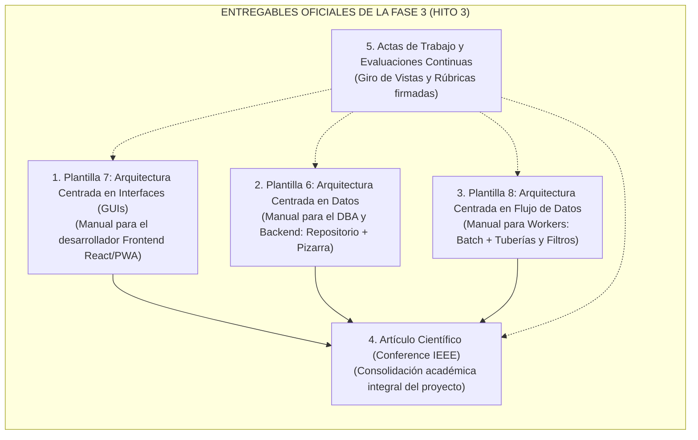
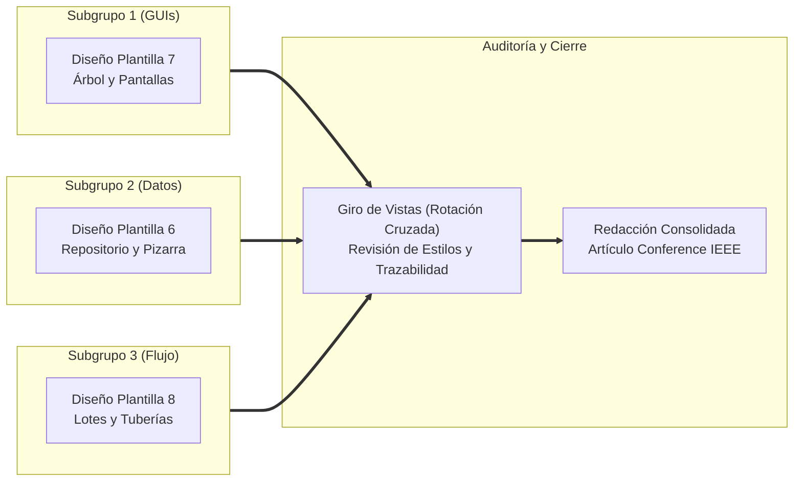

# Plan Maestro de Ejecución — Fase 3 (Hito 3)
## Diseño y Arquitectura de Software (Semestre 2026-B)
**Proyecto:** NexoVitalis360 &bull; Sistema Hospitalario Integral en Neuropediatría  
**Equipo:** RuwayLabs Perú (Grupo RUWAY) &bull; Universidad Nacional de San Agustín (UNSA)  
**Docente:** Dr. Percy Oscar Huertas Niquén  
**Ponderación Académica:** Tercera Evaluación Continua (EC3: 30%) + Tercer Examen Parcial (EX3: 10%)

---

## 1. Diagnóstico y Fundamento Doctrinal de Cátedra

Tras la culminación de la **Fase 1** (Arquitectura Genérica y Diagrama de Comportamiento) y la **Fase 2** (Vistas Lógica, Procesos y Física), el docente Dr. Percy Huertas impartió una directriz arquitectónica decisiva para la Fase 3:

> [!IMPORTANT]
> **La Doctrina del Docente (Transcripción de Cátedra):**  
> 1. *"La arquitectura no está orientada al cliente, está orientada al codificador, al desarrollador. Estas arquitecturas ni las va a conocer el cliente."*
> 2. *"¿Qué es lo primero que deben hacer? Preguntar quién va a codificar. ¿Cuál es el equipo de codificadores? Y esto entra como parte de los Requisitos No Funcionales (RNF) de la arquitectura."*
> 3. *"El catálogo de requisitos y la arquitectura se complementan en una amalgama de preguntas y respuestas. El catálogo sigue su proceso evolutivo dinámico y no termina de acero hasta que se culmine el diseño."*
> 4. *"Las arquitecturas stand-alone son las más sencillas; las más complejas son las arquitecturas distribuidas que atienden varios lugares o vía internet. Tienen que aterrizar la arquitectura."*

Bajo estas premisas, la **Fase 3** no es una repetición conceptual, sino el **aterrizaje técnico y operativo** de NexoVitalis360 en tres estilos arquitectónicos especializados que servirán de guía constructiva directa para los programadores, culminando con la redacción del **Artículo Científico en estándar IEEE**.

---

## 2. Mapa de Entregables Oficiales de la Fase 3

Conforme al Sílabo (Unidad IV) y las Diapositivas de cátedra (Diap. 3, 64-70, 105-127), la Fase 3 se compone de cuatro entregables formales en Word (`.docx`), respaldados por sus modelos gráficos vectoriales y actas de trabajo:

---

## 3. Especificación Detallada de Cada Artefacto

### Artefacto 1: Plantilla 7 — Arquitectura Centrada en Interfaces de Usuario (GUIs)
* **Destinatario Técnico:** Desarrollador Frontend (React 18 / Vite / TypeScript) y Maquetador UI/UX.
* **Plantilla Base:** [`Material del curso/Plantillas/7. Plantilla GUIS.docx`](file:///home/marco/Projects/NexoVitalis360/Material%20del%20curso/Plantillas/7.%20Plantilla%20GUIS.docx).
* **Carpeta de Diagramas:** `05_DIAGRAMAS_Y_RECURSOS_EDITABLES/07_GUIs_Interfaces/`.
* **Fundamento Teórico (Diapositivas 105–127):**
  - Los **10 Criterios de Calidad de Interfaz** del docente: Control de usuario, consistencia, retroalimentación, claridad, indulgencia ante errores, estética y adaptabilidad ergonómica.
  - Aplicación formal de las **8 Reglas de Oro de Ben Shneiderman**, las **Heurísticas de Usabilidad de Jakob Nielsen** y los principios de **Affordance y Carga Cognitiva de Donald Norman**.
* **Contenido Técnico a Modelar:**
  1. **Árbol de Navegación y Mapa de Sitio Integral:** Jerarquía de rutas por roles de seguridad (`/portal-especialista`, `/admision-recepcion`, `/portal-apoderado`).
  2. **Catálogo de Pantallas (`GUI-*`) y Modales Flotantes (`MDL-*`):** Trazabilidad biunívoca con las ilaciones del catálogo.
  3. **Especificación de Interfaces Clave:**
     - *GUI-001:* Dashboard de Especialista y Agenda Semanal interactiva.
     - *GUI-002 / MDL-001:* Agendamiento Multimodal con detección de colisiones y selección de modalidad (presencial, teleconsulta WebRTC, domicilio).
     - *GUI-003 / MDL-002:* Formulario de Pre-Triaje Clínico con alertamiento visual en tiempo real ($\text{SpO}_2 < 92\%$).
     - *GUI-004:* Historia Clínica Pediátrica con editor de notas inmutables y buscador CIE-10.
     - *GUI-005:* Módulo de Caja y Facturación Electrónica SUNAT (emisión de Boleta/Factura y visualización de CDR).
  4. **Directrices de Ergonomía y Responsive Design:** Adaptabilidad móvil para la PWA de apoderados y tablets de terapeutas en campo (Android 11+ / iOS 15+).

---

### Artefacto 2: Plantilla 6 — Arquitectura Centrada en Datos
* **Destinatario Técnico:** Administrador de Base de Datos (DBA), Ingeniero de Datos y Desarrollador Backend.
* **Plantilla Base:** [`Material del curso/Plantillas/6. Plantilla Arquitectura centrada en datos.docx`](file:///home/marco/Projects/NexoVitalis360/Material%20del%20curso/Plantillas/6.%20Plantilla%20Arquitectura%20centrada%20en%20datos.docx).
* **Carpeta de Diagramas:** `05_DIAGRAMAS_Y_RECURSOS_EDITABLES/06_Arquitectura_Centrada_Datos/`.
* **Fundamento Teórico (Diapositivas 67–70):**
  - **Estilo de Repositorio Centralizado:** Gestión de datos estructurados compartidos por múltiples componentes independientes de software.
  - **Estilo de Pizarra (*Blackboard Architecture*):** Estructura tríadica conformada por *Pizarra (Memoria Compartida)*, *Fuentes de Conocimiento (Knowledge Sources - KS)* y *Componente de Control*.
* **Contenido Técnico a Modelar:**
  1. **Componente 1: Estilo de Repositorio Centralizado (`Vitalis_BD` en PostgreSQL 16)**
     - Diagrama de Arquitectura de Almacenamiento y Conexiones: Pool `PgBouncer` para absorber concurrencia sin saturar conexiones físicas.
     - Particionamiento relacional por periodos para `TB_HISTORIAL_CITAS` y `TB_NOTAS_EVOLUCION`.
     - Mecanismo de borrado lógico (*Soft Delete*) y aislamiento transaccional *Read Committed* con bloqueos pesimistas `SELECT ... FOR UPDATE` en `TB_HORARIOS`.
     - Almacenamiento seguro de objetos BLOB cifrados en MinIO / AWS S3 para actas de consentimiento firmado y comprobantes PDF con URLs prefirmadas.
  2. **Componente 2: Estilo de Pizarra (*Blackboard*) para Soporte de Decisiones Clínicas**
     - *Estructura de Datos Pizarra:* Espacio en memoria (Redis + Estado transaccional) que alberga signos vitales del menor, motivos de consulta y antecedentes.
     - *Fuentes de Conocimiento (`KS`):*
       - `KS_AlertaRoja`: Evalúa $\text{SpO}_2 < 92\%$ o taquicardia pediátrica y activa la alarma de urgencia médica.
       - `KS_Neuropediatria`: Cruza síntomas con criterios diagnósticos preliminares (TEA/TDAH/Epilepsia).
       - `KS_ConsentimientoBioetico`: Verifica vigencia legal de patria potestad del apoderado.
       - `KS_Disponibilidad`: Resuelve horarios y especialidades concurrentes.
     - *Componente de Control:* Orquesta el orden de ejecución de las fuentes de conocimiento, consolidando la ficha clínica antes de autorizar el turno o derivar a emergencias.

---

### Artefacto 3: Plantilla 8 — Arquitectura Centrada en el Flujo de Datos
* **Destinatario Técnico:** Ingeniero de Integraciones, Desarrollador de Microservicios y Programador Backend Asíncrono.
* **Plantilla Base:** [`Material del curso/Plantillas/8. Plantilla Arquitectura centrada en el flujo de datos.docx`](file:///home/marco/Projects/NexoVitalis360/Material%20del%20curso/Plantillas/8.%20Plantilla%20Arquitectura%20centrada%20en%20el%20flujo%20de%20datos.docx).
* **Carpeta de Diagramas:** `05_DIAGRAMAS_Y_RECURSOS_EDITABLES/08_Flujo_Datos/`.
* **Fundamento Teórico (Diapositivas 64–66):**
  - **Estilo Lotes Secuenciales (*Batch Sequential*):** Ejecución por fases sucesivas donde cada paso transforma un lote completo de datos y lo entrega cerrado a la siguiente etapa.
  - **Estilo Tuberías y Filtros (*Pipes and Filters*):** Componentes independientes (*filtros*) conectados por canales de transmisión unidireccional (*tuberías*), sin estado compartido.
* **Contenido Técnico a Modelar:**
  1. **Componente 1: Estilo Lotes Secuenciales — Liquidación Periódica a Médicos (`EDU-0038`)**
     - *Lote 1 (Extracción):* `Extracción de Citas Atendidas en el Mes` desde `TB_CITAS_MEDICAS` filtrando estado `Atendida` y profesional.
     - *Lote 2 (Tarifación):* Cruce con `TB_TARIFAS_PROFESIONAL` según modalidad (presencial, teleconsulta o domicilio).
     - *Lote 3 (Deducción Contable):* Cálculo de comisión de la clínica (ej. 20%) y retención tributaria de cuarta categoría (8%).
     - *Lote 4 (Consolidación y Cierre):* Generación masiva de órdenes de pago en `TB_LIQUIDACIONES`, emisión de resúmenes contables en PDF y cierre inmutable del periodo.
  2. **Componente 2: Estilo Tuberías y Filtros — Facturación Electrónica SUNAT UBL 2.1 (`EDU-0037`)**
     - `Entrada:` Payload JSON transaccional de cobro de cita o paquete.
     - `Filtro 1 (Validador de Identidad):` Valida sintaxis y estado de DNI (8 dígitos) o RUC (11 dígitos, dígito verificador y condición Habido).
     - `Filtro 2 (Generador XML UBL 2.1):` Mapea los ítems clínicos a la estructura XML conforme a la normativa SUNAT.
     - `Filtro 3 (Firma Digital X.509):` Aplica el certificado digital criptográfico sobre el XML generando el digest y la firma obligatoria.
     - `Filtro 4 (Compresión ZIP):` Empaqueta el XML firmado según la nomenclatura oficial `RUC-TIPO-SERIE-NUMERO.zip`.
     - `Filtro 5 (Despacho SOAP/HTTPS):` Envía el paquete al OSE/SUNAT mediante transporte seguro mTLS.
     - `Filtro 6 (Procesador de CDR):` Desempaqueta la Constancia de Recepción (CDR), extrae el código de aceptación/rechazo y genera el PDF con código QR y Hash CPE en `TB_COMPROBANTES`.

---

### Artefacto 4: Artículo Científico de Conferencia (Formato IEEE)
* **Plantilla Base:** [`Material del curso/Plantillas/Articulo conference.docx`](file:///home/marco/Projects/NexoVitalis360/Material%20del%20curso/Plantillas/Articulo%20conference.docx).
* **Formato Formal:** 2 columnas, estándar oficial IEEE Conference (referencias numéricas correlativas `[1]`, `[2]`, tipografía Times New Roman).
* **Estructura Requerida por la Plantilla:**
  1. **Título, Autores y Afiliación:** RuwayLabs Perú &bull; Escuela Profesional de Ingeniería de Sistemas &bull; UNSA.
  2. **Resumen (Abstract) y Palabras Clave (Keywords):** Síntesis del problema, metodología biunívoca catálogo-arquitectura y resultados.
  3. **I. Introducción:** Planteamiento de la salud digital en neuropediatría y justificación de la ingeniería de software en salud.
  4. **II. Objetivos (Principales y Secundarios):** Objetivos del modelado y la construcción arquitectónica.
  5. **III. Experiencias en la Elaboración de la Arquitectura de Software:**
     - *El rol del catálogo de requisitos:* Trazabilidad biunívoca y retroalimentación iterativa.
     - *Diseño inicial de la arquitectura:* Selección de la arquitectura en capas y derivación de bloques.
     - *Vistas Arquitectónicas Implementadas:* Síntesis técnica de la Vista Lógica, Vista de Procesos y Vista Física.
  6. **IV. Diseño Final y Estilos Específicos:** Aterrizaje en GUIs, Datos (Repositorio/Pizarra) y Flujos (Lotes/Pipes).
  7. **V. Conclusiones y Trabajo Futuro:** Lecciones aprendidas y preparación para la codificación.
  8. **Referencias:** Bibliografía rigurosa en formato IEEE.

---

## 4. Actualizaciones Requeridas en el Catálogo de Requisitos

Para dar cumplimiento formal al mandato del profesor (*"¿Quién va a codificar? Es lo primero que tienen que hacer, y entra como RNF"*), se deben incorporar los siguientes dos nuevos requerimientos no funcionales al Catálogo oficial ([`Artefacto_Catalogo_Requisitos_v01.00.docx`](file:///home/marco/Projects/NexoVitalis360/01_LINEA_BASE_REQUERIMIENTOS/Artefacto_Catalogo_Requisitos_v01.00.docx)):

| Código | Nombre del RNF | Justificación de Cátedra | Especificación Técnica Formal |
| :---: | :--- | :--- | :--- |
| **`RNF-0026`** | **Perfil y Competencias Técnicas del Equipo de Codificadores** | *"Preguntan quién va a codificar... entra como parte de los requisitos no funcionales de la arquitectura."* | Define el perfil del equipo de desarrollo de RuwayLabs: perfil Full-Stack con dominio en TypeScript/React 18 (SPA/PWA), Python 3.12 / Django REST Framework 5.0, PostgreSQL 16 y Docker. Se especifica que el nivel de detalle de las vistas (BPMN detallado y diagramas de pantalla) obedece a garantizar la construcción sin ambigüedades. |
| **`RNF-0027`** | **Arquitectura de Pizarra para Soporte de Decisiones Clínicas** | *"La arquitectura de pizarra para sistemas con reconocimiento y análisis especializado (Diap. 70)."* | Implementación de un espacio compartido de evaluación clínica con fuentes de conocimiento desacopladas para triaje asistencial y alerta vital automática ($\text{SpO}_2 < 92\%$). |

---

## 5. Gobernanza del Equipo y Actas de Trabajo (Hito 3)

Se continuará con el protocolo de trabajo formal y la técnica del **"Giro de Vistas"** (diseño en subgrupos con rotación de auditoría cruzada antes de la entrega final):

### Actas Planificadas para la Fase 3:
1. **Acta de Trabajo N° 06 (Semana 1):** Planificación de la Fase 3, asignación de subgrupos para Plantillas 6, 7 y 8, y definición del perfil de codificación (`RNF-0026`).
2. **Acta de Trabajo N° 07 (Semana 2):** Consolidación preliminar de diagramas de GUIs, Pizarra y Tuberías/Lotes, y ejecución del "Giro de Vistas" (auditoría cruzada).
3. **Acta de Trabajo N° 08 (Semana 3):** Integración formal en plantillas Word oficiales, redacción final del Artículo de Conferencia IEEE y aprobación unánime de entrega.

---

## 6. Cronograma Sugerido de Ejecución

| Semana / Hito | Actividad Principal | Responsables | Entregables Clave |
| :---: | :--- | :---: | :--- |
| **Semana 1** | • Actualización del Catálogo (`RNF-0026` y `RNF-0027`). • Modelado de diagramas HTML5/SVG de GUIs (Plantilla 7) y Repositorio/Pizarra (Plantilla 6). • Acta de Trabajo N° 06. | Subgrupos 1 y 2 / Marco Márquez | • `fase3.md` aprobado. • Diagramas iniciales de GUIs y Pizarra. • Acta 06 firmada. |
| **Semana 2** | • Modelado de diagramas HTML5/SVG de Tuberías y Filtros / Lotes (Plantilla 8). • Redacción del cuerpo técnico de las Plantillas 6, 7 y 8. • Giro de Vistas (Auditoría cruzada entre subgrupos). • Acta de Trabajo N° 07. | Subgrupo 3 y rotación cruzada | • Borradores consolidados de Plantillas 6, 7 y 8. • Acta 07 con observaciones resueltas. |
| **Semana 3** | • Redacción integral del Artículo Científico IEEE (`Articulo conference.docx`). • Actualización del Visor HTML interactivo en GitHub Pages. • Compilación final de documentos Word y PDF a 300 DPI. • Acta de Trabajo N° 08 y Rúbricas. | Todo el equipo RuwayLabs | • Plantillas 6, 7 y 8 completas. • Artículo IEEE culminado. • Entrega lista para evaluación continua 3. |

---

*Documento preparado por RuwayLabs Perú para el seguimiento estricto del Hito 3 de Diseño y Arquitectura de Software.*
